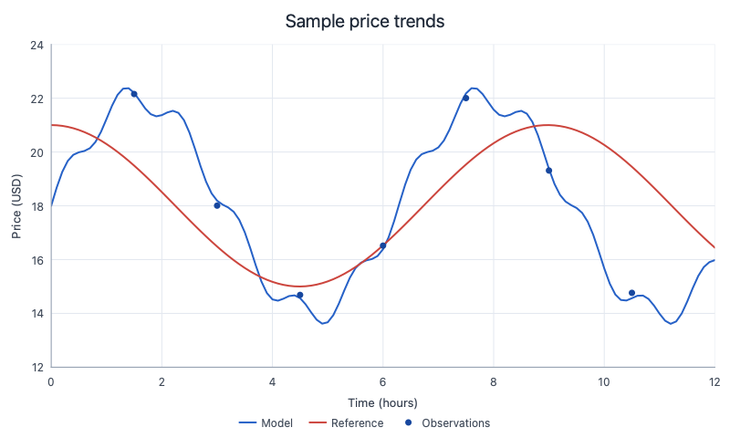

# tinychart

A C++20 line-chart library for macOS.

## Example

```cpp
#include <tinychart/macos.hpp>

int main() {
    auto plot = tinychart::makeChart({
        .title = "Price trend",
        .xLabel = "Time (hours)",
        .yLabel = "Price (USD)"
    });
    plot.addLine("Market price", {{0, 12}, {1, 18}, {2, 15}, {3, 24}});
    plot.addScatter({.label = "Observations", .points = {{0.8, 16}, {2.2, 18}}});
    tinychart::writePng(plot, "chart.png");
}
```



## Features

- Line, scatter, and bar charts with titles, axis labels, legends, light and dark themes, and hover tooltips.
- Renders an AppKit view or exports to PNG.

## How it works

- `lineChart`, `scatterPlot`, and `barChart` build a `ChartSpec` from data.
- `buildFrame` lays out the chart and records drawing commands in a `Frame`.
- `drawFrame` uses Core Graphics to draw the frame.

## Mac OS AppKit

In an Objective-C++ `NSView`, include `<tinychart/macos.hpp>` and store your chart in an `std::optional<tinychart::Chart>` named `chart_`.

```objective-c++
- (BOOL)isFlipped { return YES; }

- (void)drawRect:(NSRect)dirtyRect {
    (void)dirtyRect;
    const auto size = self.bounds.size;
    if (!chart_ || size.width <= 0 || size.height <= 0) return;

    tinychart::MacTextShaper text;
    auto frame = tinychart::buildFrame(chart_->spec(), {size.width, size.height}, text);
    tinychart::drawFrame(NSGraphicsContext.currentContext.CGContext, frame);
}
```

Set `needsDisplay` when your data changes. If the view redraws frequently, cache the frame and rebuild it when the data or view size changes, as in the [AppKit demo](examples/chart_demo.mm).

For hover, build a layer with `frame.hoverOverlay(cursor, text)` and pass its address to `drawFrame`. Use `frame.nearestPoint(cursor, radius)` for a custom tooltip.

## Install

Requires Apple Command Line Tools, CMake 3.24 or later, and Ninja.

```sh
brew install cmake ninja
cmake --preset dev
cmake --build --preset dev
./build/dev/render_chart build/dev/sample.png
./build/dev/render_chart build/dev/sample@2x.png 2
./build/dev/render_chart build/dev/dark.png --dark
open build/dev/chart_demo.app
```

Choose an appearance from the demo’s **Theme** menu, or use `.theme = tinychart::Theme::MarketDark` in `makeChart`.
